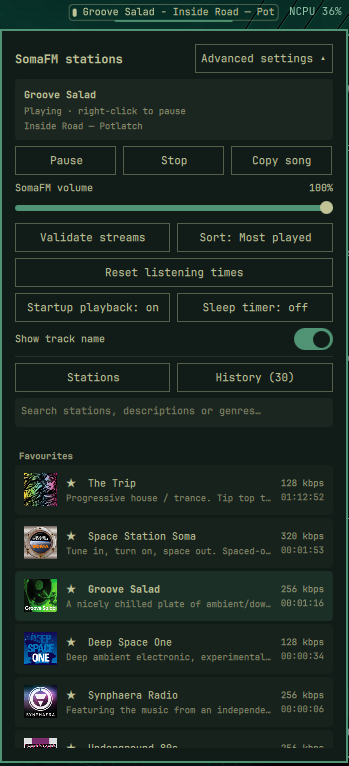

# SomaFM

Always-on-top radio widgets for [SomaFM](https://somafm.com/), a free streaming radio service. If you enjoy listening, please consider [supporting SomaFM](https://somafm.com/support/).

| Platform | Folder | What it is |
|---|---|---|
| Omarchy | [`omarchy/`](omarchy/) | Quickshell bar widget (QML + Python helpers). The reference design. |
| macOS | [`macOS/`](macOS/) | Menu bar app (Swift), styled after the Omarchy widget. |

## Keeping the platforms in step

[`docs/SPEC.md`](docs/SPEC.md) is the shared specification: layout, colours, behaviour, stored settings, and a status table of what each platform does and does not support. [`AGENTS.md`](AGENTS.md) says how to work across both: change the spec, then mirror the change in each build, and only report a platform as done once it has actually been built and run.

## License

MIT, see [LICENSE](LICENSE).
